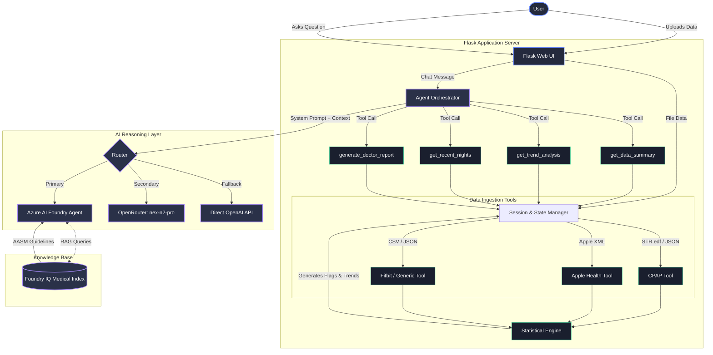

# Sleep IQ Architecture

The Sleep IQ application uses a multi-agent orchestration pattern to parse raw health data, extract statistical trends, and reason over the findings to provide grounded health insights.

## System Workflow

## Core Components

### 1. Data Ingestion & Statistical Engine
Rather than passing raw, multi-megabyte XML or EDF files directly to an LLM (which breaks context windows), Sleep IQ first processes the data locally. The Statistical Engine extracts critical 95th percentiles, median compliance, and multi-month trends, boiling down millions of data points into a concise JSON state object.

### 2. The Orchestrator
The `orchestrator.py` module acts as the brain. When a user asks a question, the Orchestrator evaluates what data is needed and calls the appropriate Python tools. For example, if the user asks *"How has my sleep improved?"*, the Orchestrator will autonomously call the `get_trend_analysis` tool before formulating a response.

### 3. LLM Routing (Agents League Priority)
The application prioritizes Microsoft AI stack per competition requirements:
- **Primary:** Azure AI Foundry Agent (via `azure-ai-projects` SDK).
- **Secondary:** OpenRouter API (for local dev without Azure).
- **Fallback:** Direct Azure OpenAI or OpenAI API.

### 4. Foundry IQ Grounding (Microsoft IQ Layer)
The agent is grounded by **Foundry IQ** — the Microsoft IQ intelligence layer for agentic knowledge retrieval. It pulls cited snippets from AASM clinical guidelines, ResMed clinical recommendations, and NIH sleep research.
- **Azure AI Search mode (primary):** If `FOUNDRY_IQ_ENDPOINT`, `FOUNDRY_IQ_INDEX_NAME`, and `FOUNDRY_IQ_API_KEY` are configured in `.env`, the system queries an Azure AI Search index for semantically grounded retrieval. Seed the index with `python scripts/seed_search_index.py`.
- **Embedded fallback:** An offline knowledge base with 10+ entries covering AHI classification, CPAP therapy thresholds, leak management, compliance standards, EPR settings, central apnea, pressure titration, HRV norms, SpO2 interpretation, and sleep stage architecture. Keyword-based scoring retrieves the most relevant entries.
- **Citation requirement:** Every AI answer must cite its source. The system prompt is dynamically augmented with knowledge snippets before each agent invocation.
